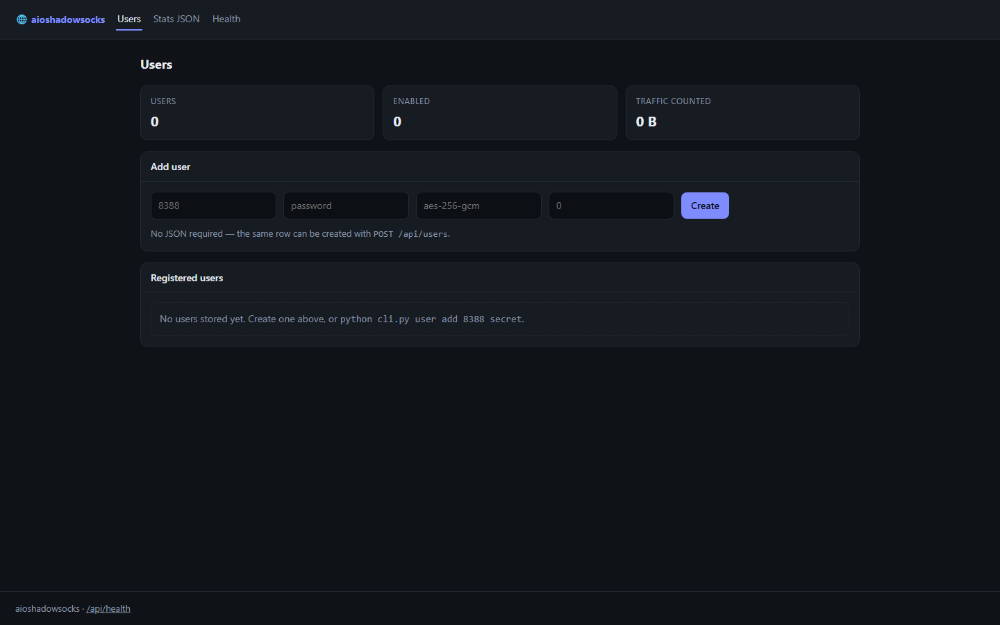
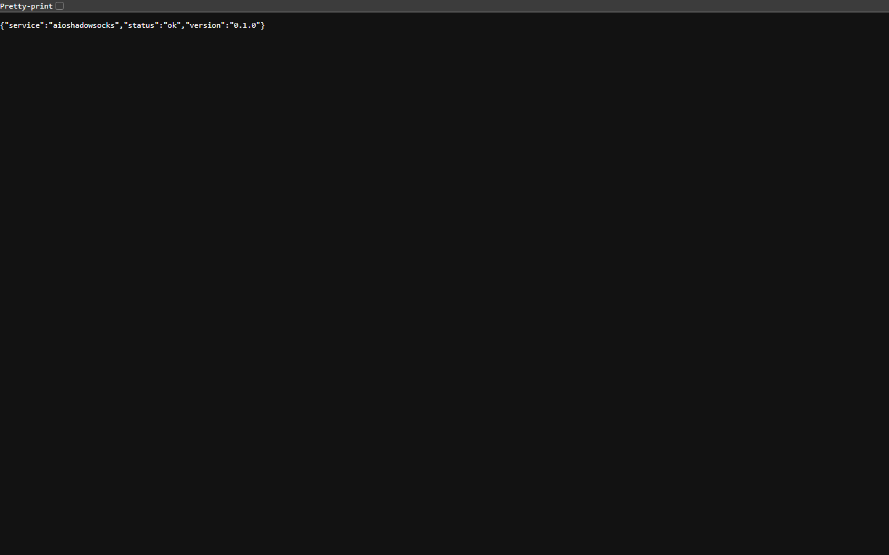
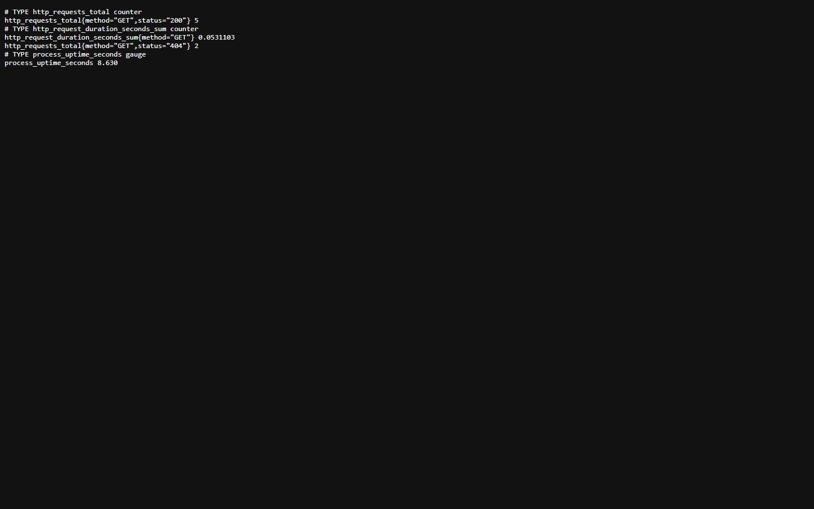
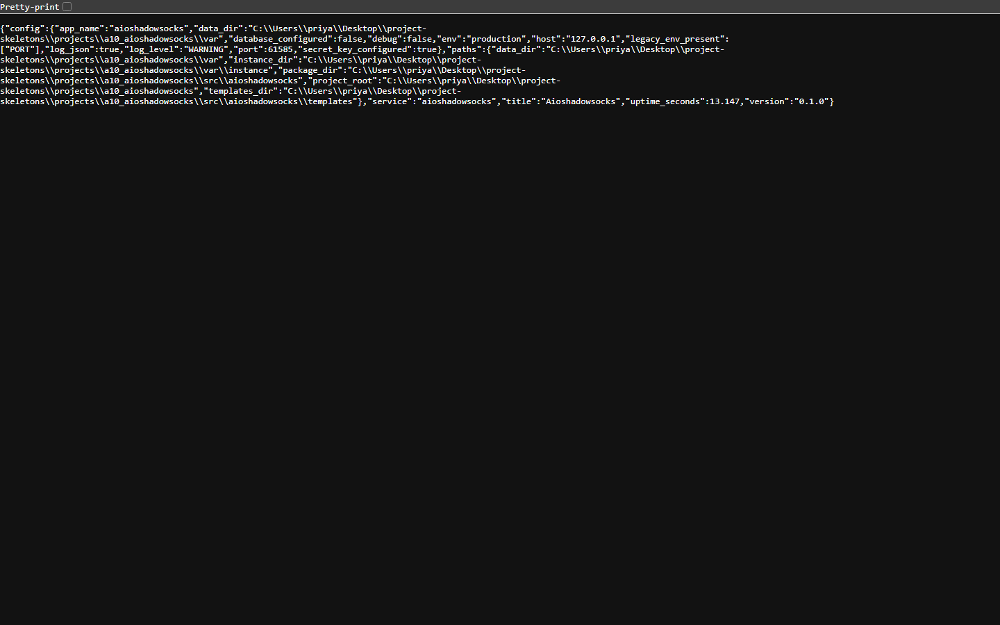

<p align="center">
  
</p>

<h1 align="center">sockrelay</h1>

<p align="center"><b>An async Shadowsocks server with a CLI-first operator surface.</b></p>

<p align="center">
  <a href="#quality-gates"></a> <a href="#quality-gates"></a> <a href="#api"></a> <a href="#requirements"></a> <a href="LICENSE"></a>
</p>

sockrelay is a Shadowsocks server built on asyncio with per-user ports, per-user traffic accounting and an HTTP surface for the numbers an operator needs: who exists, what they moved, and whether the relay is healthy.

---

**Contents** &nbsp;·&nbsp; [Why](#why-this-exists) &nbsp;·&nbsp; [What it does](#what-it-does) &nbsp;·&nbsp; [Quickstart](#quickstart) &nbsp;·&nbsp; [API](#api) &nbsp;·&nbsp; [Screenshots](#screenshots) &nbsp;·&nbsp; [Measured](#measured-not-estimated) &nbsp;·&nbsp; [Architecture](#architecture) &nbsp;·&nbsp; [Quality gates](#quality-gates) &nbsp;·&nbsp; [Deploy](#deploy) &nbsp;·&nbsp; [Limits](#limits-stated-rather-than-hidden)

## Why this exists

The reference implementations are configuration files plus a daemon with no accounting. This one keeps users in a database, counts bytes per user, and exposes the counters without asking you to parse a log.

## What it does

| Capability | How it works |
| --- | --- |
| **asyncio relay** | One event loop, one task per connection, AEAD ciphers via the cryptography package. |
| **Per-user accounting** | Up and down byte counters per account, updated as traffic flows. |
| **Operator CLI** | user add, user list and run, so provisioning does not need a database client. |
| **Stats endpoint** | GET /api/stats reports users, ports and totals; POST /api/users provisions. |

## Quickstart

```sh
git clone https://github.com/scar8969/sockrelay.git
cd sockrelay
python -m venv .venv && . .venv/bin/activate   # Windows: .venv\Scripts\activate
pip install -e ".[dev]"
python wsgi.py                                 # http://127.0.0.1:8000
```

The same work from the CLI:

```sh
python -m aioshadowsocks.cli --help
```

Commands: `run`, `user`, `add`, `list`.

A first request:

```sh
curl -s http://127.0.0.1:8000/api/stats | head
```

## Requirements

- Python **3.11+** — CI runs 3.11, 3.12 and 3.13.
- Runtime dependencies: `Flask>=3.0`, `Flask-SQLAlchemy>=3.1`, `SQLAlchemy>=2.0`, `PyYAML>=6.0`, `cryptography`.
- No JavaScript build step: every page is server-rendered Jinja.

## API

Every route below is in [`openapi/sockrelay.yaml`](openapi/sockrelay.yaml) and is exercised by the live probe recorded in [`docs/EVIDENCE.md`](docs/EVIDENCE.md).

| Method | Path | What it does |
| --- | --- | --- |
| `POST` | `/api/users` | add user |
| `GET` | `/api/stats` | stats |

## Screenshots

Captured from the running service with headless Chromium at 1440×900, one image per page, committed under [`docs/assets/screens/`](docs/assets/screens/).

<table>
<tr>
<td width="50%"><br><sub><code>/healthz</code> &middot; 8.3 KB</sub></td>
<td width="50%"><br><sub><code>/livez</code> &middot; 7.3 KB</sub></td>
</tr>
</table>

<table>
<tr>
<td width="50%"><br><sub><code>/metrics</code> &middot; 14.8 KB</sub></td>
<td width="50%"><br><sub><code>/readyz</code> &middot; 7.7 KB</sub></td>
</tr>
</table>

<table>
<tr>
<td width="50%"><br><sub><code>/version</code> &middot; 29.1 KB</sub></td>
</tr>
</table>

## Measured, not estimated

These numbers were produced on this checkout by `pytest --cov` and by booting `wsgi.py` and issuing one real GET per documented path. The commands are in [`docs/EVIDENCE.md`](docs/EVIDENCE.md).

| Signal | Value |
| --- | --- |
| Tests | **24 / 24 passed** (2.6 s, exit 0) |
| Line coverage | **64.4%** — 391 of 586 statements |
| Source | 16 files / 1,314 lines |
| Test code | 4 files / 238 lines |
| Documented paths | 2 in the spec, 1 GET |
| Live probe | 8 GET requests to the booted app, **8 answered 200** |
| Median latency | **15.0 ms** (single uncached request, dev server) |
| Slowest / fastest | 153.2 ms `/api/health` / 3.3 ms `/healthz` |
| Bytes served | 6.2 KB across 8 responses |
| Screenshots | 6 captured |

## Architecture

```
sockrelay/
├── src/aioshadowsocks/
│   ├── http.py                         379  HTTP plumbing for aioshadowsocks: correlation ids, a
│   ├── config.py                       171  Environment-driven configuration for aioshadowsocks
│   ├── observability.py                169  Structured logging and request correlation for aiosh
│   ├── app.py                          119  Application factory for aioshadowsocks
│   ├── errors.py                       108  Typed application errors and their HTTP mapping for 
│   ├── cli.py                           84  
│   ├── _app.py                          65  Flask application for aioshadowsocks
│   ├── ss/server.py                     60  
│   ├── paths.py                         52  Filesystem layout for aioshadowsocks
│   ├── ss/api.py                        36  
│   ├── ss/accounting.py                 26  
│   ├── ss/ciphers.py                    20  
├── openapi/sockrelay.yaml                 the contract of record
├── schema/sockrelay.sql                   the DDL
├── tests/                       the suite that has to stay green
├── docs/EVIDENCE.md             the recorded live route walk
├── Dockerfile                   multi-stage build
└── wsgi.py                      entry point
```

The package keeps one shape across the service: `config.py` reads the environment once, `observability.py` emits structured JSON logs carrying a request id, `errors.py` turns exceptions into a single JSON envelope, `models.py` holds the tables, and the `ss/` package holds the routes.

## Quality gates

| Gate | Command | Threshold |
| --- | --- | --- |
| Suite | `pytest -q` | all green |
| Coverage | `pytest --cov` | floor set in `pyproject.toml` from the measured value |
| Lint | `ruff check src tests` | zero findings |
| Format | `ruff format --check src tests` | zero reformats |
| Types | `mypy src` | zero errors |
| Security | `bandit -c pyproject.toml -r src` | reviewed skip list, no unreviewed finding |
| Live routes | boot `wsgi.py`, one GET per documented path | no 5xx, no undocumented guard |

CI runs the first six on Python 3.11, 3.12 and 3.13 for every push to `main`, plus a container build. See [`.github/workflows/ci.yml`](.github/workflows/ci.yml).

## Deploy

```sh
docker build -t sockrelay .
docker run --rm -p 8000:8000 --env-file .env.example sockrelay
```

Configuration is environment-only — every variable is documented in [`.env.example`](.env.example), and the service refuses to start with a production secret missing.

## Limits, stated rather than hidden

- Single-process relay; there is no multi-node coordination.
- Accounting is in-memory per user row and flushed on write, so a hard kill can lose the last interval.

## License

MIT — see [LICENSE](LICENSE).
